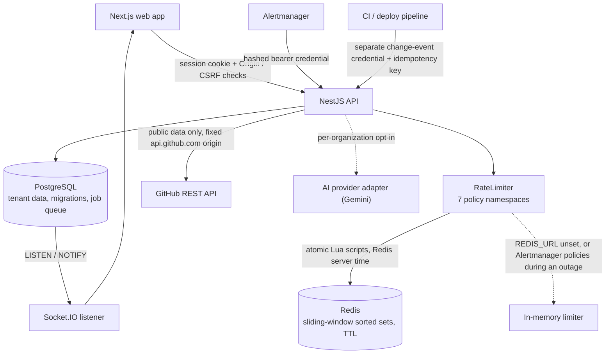
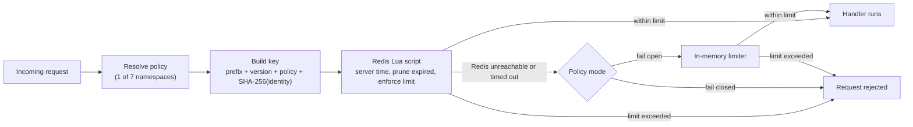
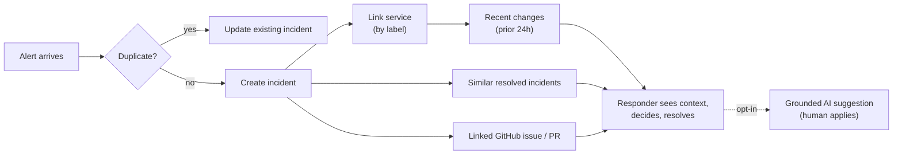

<div align="center">

# Incident Intelligence Platform

**A multi-tenant incident operations platform that turns raw alerts into context-rich, auditable incidents.**
Alert intake and deduplication · similar-incident retrieval · change correlation · GitHub context · opt-in grounded AI · Redis-backed rate limiting.
Built on a zero budget, with every safety claim backed by a test or marked as unverified.

<a href="https://github.com/aayushtiwari307/incident-intelligence-platform/actions/workflows/ci.yml"></a>


[Highlights](#-highlights) · [Features](#-features) · [Architecture](#-architecture) · [Rate limiting](#-redis-backed-rate-limiting) · [Quick start](#-quick-start) · [Evidence](#-what-is-verified-and-what-is-not) · [Docs](#-documentation-map)

**Live demo:** https://incident-intelligence-free-demo.onrender.com
<br/>
<sub>Sign-in is invite-only (public registration is disabled in production by design). The demo runs on a free tier, so the first request after idle time can be slow.</sub>

</div>

---

## 📌 Status at a glance

> [!NOTE]
> **As of 2026-11-06, Milestones M1–M10 are complete, deployed, and verified.** CI is green. The live demo runs on Render Free + Neon.
>
> **Redis-backed rate limiting has been implemented, tested, and merged into `main` through [PR #9](https://github.com/aayushtiwari307/incident-intelligence-platform/pull/9)** (see the
> [verified results](#redis-rate-limiting-pr-9--final-verified-results)). **Redis is not configured on the public Render demo**, which
> runs a single API instance.
>
> On Render, the backend real-time listener started successfully (`listening: true`) and the frontend real-time build flag is
> enabled; a live two-tab, same-session test passed earlier. The Gemini provider is enabled in the Render server configuration,
> but each organization must still opt in separately. One genuine Gemini request was verified **locally with synthetic data**;
> **no Gemini request has been made from the public Render deployment**. A GitHub Actions keepalive (five-minute schedule,
> best-effort) was added. See the [evidence table](#-what-is-verified-and-what-is-not) for exactly what is proven and what is not.

---

## 🎯 Highlights

- **Multi-tenant by design:** four RBAC roles, tenant taken from the session only, and composite foreign keys so the database itself refuses cross-tenant links.
- **Distributed rate limiting:** atomic sliding-window limits in Redis (Lua scripts, Redis server time) across seven policies, each with its own fail-open or fail-closed behaviour.
- **No message broker needed:** a durable PostgreSQL job queue (`SKIP LOCKED`, leases, fencing) and real-time updates via `LISTEN/NOTIFY` + Socket.IO.
- **Safe AI:** incident context is best-effort redacted before it is sent to the provider; generated output is independently schema- and provenance-validated (verbatim-quote citations) and applied only by a human.
- **Evidence over claims:** CI, 324 API tests and 21 dedicated Redis tests, a container smoke test, a real Alertmanager sender and a backup/restore drill, each marked verified or unverified below.

---

## ✨ Features

| Capability | What it does |
|---|---|
| **Multi-tenant workspaces** | Organizations with four roles (`viewer` → `responder` → `admin` → `owner`), email-bound single-use invitations, and invite-only registration in production. Tenant identity always comes from the authenticated session, never from the request. |
| **Hardened auth** | `scrypt` password hashing, opaque revocable sessions stored hashed, `HttpOnly` `__Host-` cookie, CSRF and browser-`Origin` checks, and [Redis-backed rate limits](#-redis-backed-rate-limiting) on login and registration. |
| **Distributed rate limiting** | Seven policies enforced by atomic Redis sliding windows, with in-memory limiting when Redis is not configured. Covers login, registration, Alertmanager intake, failed webhook authentication and AI requests. |
| **Incident lifecycle** | Validated status transitions, optimistic concurrency (stale writes get `409`), and an append-only, audited timeline of every change. |
| **Alertmanager intake** | `POST /api/v1/integrations/alertmanager` accepts Prometheus Alertmanager webhook v4, authenticates with a hashed bearer credential (rotate / revoke supported), and **deduplicates** by integration + fingerprint + `startsAt`. |
| **Similar incidents (no AI)** | PostgreSQL weighted full-text search over resolved incidents, tenant-scoped, with matched terms shown. Includes a reproducible evaluation harness. |
| **Grounded AI suggestions (opt-in)** | Gemini 3.5 Flash-Lite provider (a mock provider is used in tests), enabled server-side by configuration, with each organization opting in separately. The model sees the incident plus at most five similar resolved incidents, best-effort redacted. Output is validated against a strict schema and must cite sources by alias with verbatim quotes (provenance check). Suggestions are rate-limited and quota-limited, and only a human can apply them. |
| **Service and change context (M10)** | Per-organization service catalog, a separate change-event webhook (idempotent), and an incident panel listing changes from the 24 hours before the incident, labelled *"correlation, not proven cause."* |
| **GitHub issue/PR enrichment** | Opt-in per organization with a repository allow-list. Public data only, fixed `api.github.com` origin, no redirects, bounded responses, ETag caching, quota-aware rate limiting and a circuit breaker. No GitHub token is stored. |
| **Real-time updates** | Socket.IO fed by PostgreSQL `LISTEN/NOTIFY`. The handshake checks the session cookie and `Origin`; only organization-filtered messages are broadcast. Needs a direct (non-pooled) database URL. Enabled in the Render configuration (backend listener verified, frontend build flag on). |
| **Durable job queue** | PostgreSQL-backed, with no broker and no Redis dependency: `FOR UPDATE SKIP LOCKED`, leases with fencing, retries with backoff, and poison-job isolation so one bad job cannot starve healthy ones. |
| **Control Room UI** | A dark, keyboard-friendly interface with a sidebar, status progress track, severity indicators and instructive empty states. Deployed on the live demo. |

---

## 🏗 Architecture



### Rate-limit decision flow



### From alert to context



**Design stance:** a modular monolith with a background worker. PostgreSQL is the single source of truth for application data and
the background job queue. There is **no ORM** (handwritten SQL with `pg` and numbered, never-edited migrations). Redis is
**optional** and used only for rate limiting; without it the API falls back to in-memory limiting. **No paid services** are required
for local development.

---

## 🚦 Redis-backed rate limiting

> [!IMPORTANT]
> **Status: implemented, tested, and merged through [PR #9](https://github.com/aayushtiwari307/incident-intelligence-platform/pull/9) into `main`.**

The API uses one asynchronous `RateLimiter` interface (`consume()`, `peek()`, `reset()`) for both process-local and distributed
limiting. When `REDIS_URL` is set, `RedisRateLimiter` enforces limits in Redis so they hold across API processes. When it is unset,
the in-memory `SlidingWindowLimiter` is used, so Redis is never required for startup.

### Policies

| # | Policy | Scope | Limit | Window | If Redis is unavailable |
|:-:|---|---|---:|---:|---|
| 1 | **Login by IP** | Per IP | 100 | 15 min | **Fail closed** |
| 2 | **Login by account** | Per account + IP | 5 | 15 min | **Fail closed** |
| 3 | **Registration by IP** | Per IP | 10 | 1 hour | **Fail closed** |
| 4 | **Alertmanager by IP** | Per IP | 600 | 1 min | **Fail open** → in-memory fallback (process-local limits still enforced) |
| 5 | **Webhook failed authentication** | Failed attempts | 20 | 5 min | **Fail closed** |
| 6 | **Alertmanager integration** | Per integration | 300 | 1 min | **Fail open** → in-memory fallback (process-local limits still enforced) |
| 7 | **AI requests by user** | Per user, global across organizations | 5 | 10 min | **Fail closed** |

A valid Alertmanager integration is never rejected solely because the failed-authentication preflight cannot reach Redis; invalid
credentials still fail closed. Registration uses a more permissive 10,000/hour override in the test environment only.

### Engineering details

| Concern | How it works |
|---|---|
| **Atomic sliding window** | Requests are recorded in Redis Sorted Sets, one member per unique request. Lua scripts remove expired entries and enforce the policy counter in a single atomic call, so concurrent API instances cannot race each other. The scripts back `consume()`, `peek()` and `reset()`. |
| **Redis server time** | The scripts take their timestamp from Redis itself, not from the application host, so clock skew between API instances cannot distort a window. |
| **Policy-specific failure mode** | Security-sensitive entry points (login, registration, failed webhook authentication, AI requests) **fail closed**: an outage cannot become a way around the limit. The two Alertmanager policies (by IP, by integration) **fail open** to the in-memory limiter during a Redis outage, so alert delivery keeps working. That fallback still enforces limits, but only per API process, not across instances. |
| **Bounded connection handling** | TCP connect is capped at 1 s. The full Redis handshake and each dispatched command have separate 5 s absolute deadlines. Commands waiting to be written have a 1 s queue timeout. A timed-out operation destroys its client, offline queuing is disabled, and the next request reconnects after a short cooldown. Redis clients are closed on API shutdown. |
| **Privacy-safe keys** | Key = fixed application prefix + version + one of the seven policy namespaces + a **SHA-256 hash** of the identity. Raw email addresses and IP addresses never appear in Redis keys. Every key has a TTL and expires after its policy window. |
| **AI limits follow the user** | The AI limiter is keyed on the user's **global user ID**, so switching organizations does not reset the allowance. |
| **Successful-login reset** | A successful login resets that account's login counter, so legitimate users are not locked out by earlier typos. Failed attempts keep counting. |

<details>
<summary><b>Run it locally</b> (Redis is optional)</summary>

Start the existing Redis service from the repository root. It listens on loopback at `127.0.0.1:6380`:

```bash
docker compose up -d redis
```

Then configure the API process:

```bash
# PowerShell
$env:REDIS_URL="redis://127.0.0.1:6380"

# CMD
set REDIS_URL=redis://127.0.0.1:6380

# Bash
export REDIS_URL="redis://127.0.0.1:6380"
```

If `REDIS_URL` is unset, the API uses in-memory limiting. Run the dedicated Redis test suite with:

```bash
npm run test:redis -w @platform/api   # needs Redis 7 and a loopback TEST_DATABASE_URL
```

</details>

**Scope of the claim.** CI is configured to run the dedicated Redis suite against Redis 7. The demo currently runs one API instance;
production multi-instance behaviour and a Render Valkey configuration have not been established or configured.

---

## 🧰 Tech stack

| Layer | Choice |
|---|---|
| Web | Next.js 16 (App Router), React 19, TypeScript |
| API | NestJS 11 with framework-free handlers behind thin controllers |
| Data | PostgreSQL 16, raw SQL via `pg`, 14 numbered migrations |
| Rate limiting | Optional Redis sliding window (atomic Lua scripts, Redis 7 in CI) with an in-memory limiter fallback |
| Real-time | Socket.IO 4.8 over PostgreSQL `LISTEN/NOTIFY` |
| Validation | Zod 4, shared between API and web (`packages/shared`) |
| AI (optional) | Gemini 3.5 Flash-Lite adapter with schema-validated, citation-checked output |
| Testing | Jest, real-PostgreSQL and real-Redis integration tests, Node test runner for scripts |
| Delivery | Docker Compose, Caddy single-origin proxy, GitHub Actions (CI + best-effort keepalive) |
| Hosting (demo) | Render Free + Neon Free (₹0) |

---

## 🚀 Quick start

Requirements: **Node 22+**, npm 10+, Docker (for the local PostgreSQL). Windows CMD and PowerShell walkthroughs are in
[`docs/DEVELOPMENT.md`](docs/DEVELOPMENT.md).

```bash
npm ci
npm run setup:env      # creates a local .env with generated secrets
npm run services:up    # starts PostgreSQL on 127.0.0.1:5545
npm run migrate        # applies migrations 0001-0014
npm run dev:api        # API on http://127.0.0.1:3001
# in a second terminal
npm run dev:web        # web on http://127.0.0.1:3000
```

> [!WARNING]
> Open **`http://127.0.0.1:3000`**. The session cookie is host-only. Use `127.0.0.1` consistently instead of switching between
> `localhost` and `127.0.0.1`; a cookie set for one hostname is not sent to the other.

Redis is optional locally. To exercise distributed rate limiting, see [Run it locally](#-redis-backed-rate-limiting).

**Try the integrations locally** (loopback only, tokens are created in the Team page and never committed):

```bash
npm run simulate:alertmanager   # fire sample alerts at the Alertmanager webhook
npm run simulate:change         # send a sample deploy/change event
```

---

## 🧪 Testing

```bash
npm run check:deps && npm run check:hygiene
npm run typecheck && npm run lint
npm test                    # unit tests (scripts, shared, API, web)
npm test -w @platform/api   # API unit tests only, with Redis-specific tests excluded
npm run test:integration    # real PostgreSQL, loopback only
npm run test:redis -w @platform/api  # dedicated real-Redis tests; Redis 7 and loopback TEST_DATABASE_URL must be available
npm run build
npm run smoke:stack         # against the running container stack
```

> `smoke:stack` also checks real-time. For a local run, set `REALTIME_ENABLED=true` in your `.env` and recreate the API
> container first, otherwise its real-time checks fail by design.

Integration tests **fail closed** unless the database host is loopback, so they cannot touch a hosted database. CI also builds
the full container stack, smoke-tests HTTP and WebSocket behaviour (including a negative control that must fail when real-time is
off), and repeats the smoke test through the single-origin proxy.

---

## ✅ What is verified, and what is not

Every claim here is tied to a date and a kind of evidence. Nothing is rounded up.

### Redis rate limiting (PR #9) · final verified results

| Check | Result |
|---|---:|
| Redis test suites | 3/3 passed |
| Redis tests | 21/21 passed |
| Full API test suites | 31/31 passed |
| Full API tests | 324/324 passed |
| API typecheck | Passed |
| API build | Passed |

### Platform-wide evidence

| Area | Evidence | Status |
|---|---|---|
| Redis rate limiting | Implemented, tested and merged through [PR #9](https://github.com/aayushtiwari307/incident-intelligence-platform/pull/9) into `main`; results in the table above. No Redis/Valkey service is configured for the Render demo, and multi-instance production behaviour is not established | ✅ Verified in tests · demo not Redis-backed |
| Whole platform M1–M10 | Windows run on 2026-10-25 at `d89f800`: clean `npm ci`, typecheck, lint, **537 unit/script tests**, **271 real-PostgreSQL integration tests (21 suites)**, production build. These counts are from that earlier commit and are not directly comparable to the API-only figures above | ✅ Verified locally |
| Container stack | `smoke:stack` passed **20/20** checks against rebuilt images, including real-time authentication, delivery, tenant isolation and logout | ✅ Verified locally |
| Demo deployment | Render Free + Neon at https://incident-intelligence-free-demo.onrender.com; `/health/live` and `/health/ready` return OK | ✅ Live runtime verified |
| Keepalive workflow | A GitHub Actions workflow is scheduled every five minutes to ping the Render service. Scheduled runs are **best-effort**: GitHub may delay or skip them. The first **manual** run received HTTP 200 from Render; reliable **recurring scheduled** execution has not been verified | 🟡 Manual run verified · scheduled runs unverified |
| Continuous integration | Latest run on `main` is green | ✅ Passing |
| Dependency audit | `npm audit` reported **0 vulnerabilities** on the 2026-10-25 tree (547 packages) | ✅ Clean on 2026-10-25 |
| GitHub enrichment (0013) | Repository/PR association and the API/UI paths are implemented and tested. Live PR/issue detail retrieval remains unverified: the earlier live attempt returned `rate_limited` | 🟡 Live detail retrieval unverified |
| Service and change context (0014) | Live change event `live-check-001` appeared in Incident #3's service/change context, and the service association and event details persisted after refresh. Correlation is contextual evidence only; causation is **not** proven | ✅ Live persistence verified |
| Registration policy | Invite-only default in production, covered by code and tests | 🟡 Not separately checked on the live service |
| Real-time | Integration tests and the 20/20 container smoke test cover authentication, delivery, tenant isolation and logout. On Render, backend listener startup was verified (`listening: true`) and the frontend real-time build flag is enabled. A live **two-tab** test (Triggered → Acknowledged in one tab updated the other without refresh) was run earlier in the **same browser session**; there is **no independent-user verification** | ✅ Listener verified · 🟡 two-tab, same-session only |
| Alertmanager intake | 8 synthetic live scenarios passed (including 5 concurrent deliveries → 1 incident + 4 duplicates). A real `prom/alertmanager` container then delivered an authenticated alert to the deployed app and created Incident #6. Deduplication and resolution were verified with the synthetic scenarios | ✅ Verified |
| Grounded AI (Gemini) | Gemini 3.5 Flash-Lite provider. One genuine request was run **locally** on a synthetic incident; it returned source-grounded suggestions that passed the existing validation flow. Provider tests passed 5/5. The provider is enabled in the Render server configuration, but organization-level opt-in is separate. An OpenAI adapter exists with unit tests only | 🟡 Verified locally on synthetic data · **no Gemini request has been made from the public Render deployment** |
| Backup / restore | Guarded scripts and focused safety tests; a disposable local PostgreSQL backup/restore verification passed on 2026-11-02 | ✅ Verified locally, not a production restore drill |

<details>
<summary><b>Retrieval quality (M8)</b></summary>

On a *synthetic, single-author* corpus of 32 resolved incidents, weighted English full-text search scored Recall@5 **0.82** against
**0.60** for a plain full-text baseline (+0.22; paired bootstrap interval +0.09 to +0.34). The point estimate met the pre-declared
+0.10 gate, but the interval's lower bound does not, and the corpus is not production data. Treat it as a regression guard, not
proof of real-world relevance. Protocol and corpora are in [`docs/verification/`](docs/verification/).

</details>

---

## 🔒 Security model

- **Tenancy:** the organization comes from session membership. Tenant tables use composite foreign keys, and cross-tenant reads return `404`.
- **Authorization:** enforced in the API by role; the browser is never trusted.
- **Abuse protection:** seven rate-limit policies cover login, registration, Alertmanager intake, failed webhook authentication and AI requests. Auth-sensitive policies fail closed, and Redis keys contain only hashed identities. See [Redis-backed rate limiting](#-redis-backed-rate-limiting).
- **Webhooks:** bearer credentials are shown once and stored only as hashes. Alert and change credentials are different kinds and cannot be swapped. The body is read only after the credential is verified and is size-capped.
- **Outbound calls:** GitHub requests go only to a fixed origin, with no redirects, response-size caps and sanitised remote text. External content is never sent to AI.
- **AI safety:** opt-in per organization, a per-user rate limit and a daily quota. Incident context is best-effort redacted before it is sent to the provider. Generated output is independently validated: a strict output schema, and citations that must quote the sent source verbatim. Changes are applied only by a human. Redaction is best-effort, not a guarantee. Citations prove *where* text came from, not that it is *correct*, and the UI says to verify.
- **Operations:** migrations are never edited after being applied, destructive scripts are loopback-only, and the repository hygiene check blocks secret-looking files.

---

## 🎓 Engineering concepts this project demonstrates

- **Atomic sliding-window rate limiting:** Redis Lua scripts with server-side time, so concurrent instances share one consistent window.
- **Fail-open vs fail-closed design:** the failure mode is chosen per policy, based on what an outage would put at risk.
- **Optimistic concurrency control:** version checks return `409` instead of silently overwriting.
- **Idempotency:** webhook deduplication and unique keys make retries safe.
- **Row-level locking:** `FOR UPDATE`, `FOR KEY SHARE` and `SKIP LOCKED` for races and queue claiming.
- **Lease fencing:** a stale worker cannot commit a job it no longer owns.
- **Composite foreign keys for multi-tenancy:** the database itself refuses cross-tenant links.
- **LISTEN/NOTIFY:** push updates without a message broker.
- **Conditional HTTP caching (ETag)** and a **circuit breaker** for an external API.
- **Provenance checking for LLM output:** verbatim-quote validation instead of trusting the model.
- **Bootstrap confidence intervals:** honest evaluation on a small corpus.

---

## 🗺 Roadmap

- [x] M1–M5: auth, organizations, incident workflow, durable queue, real-time, hardening
- [x] M6: free-tier deployment (Render + Neon)
- [x] M7: Alertmanager intake and deduplication
- [x] M8: similar incidents without AI, with evaluation
- [x] M9: grounded AI and safety
- [x] GitHub issue enrichment (association and API/UI paths implemented and tested)
- [x] M10: service catalog and change context
- [x] Full-tree verification on `main` (2026-10-25)
- [x] Disposable local PostgreSQL backup/restore verification (2026-11-02)
- [x] Real-time: Render backend listener verified; two-tab test in the same browser session (no independent-user claim)
- [x] Genuine local Alertmanager container delivery to Render verified (Incident #6)
- [x] Gemini adapter implemented for M9 grounded suggestions
- [x] One genuine local Gemini request verified with synthetic incident data (2026-11-05); no Gemini request from the public Render deployment
- [x] Control Room redesign deployed to Render
- [x] Best-effort GitHub Actions keepalive added (first manual run returned HTTP 200; scheduled runs not yet verified)
- [x] **Redis-backed rate limiting:** seven policies implemented, tested, and merged through [PR #9](https://github.com/aayushtiwari307/incident-intelligence-platform/pull/9) into `main`
- [ ] Successful live GitHub PR/issue detail retrieval

---

## 📚 Documentation map

| Topic | Where |
|---|---|
| Local development (Windows and Unix) | [`docs/DEVELOPMENT.md`](docs/DEVELOPMENT.md) |
| Architecture decisions | [`docs/decisions/`](docs/decisions/) |
| Alertmanager webhook | [`docs/integrations/alertmanager.md`](docs/integrations/alertmanager.md) |
| Change-event webhook | [`docs/integrations/change-events.md`](docs/integrations/change-events.md) |
| Gemini grounded suggestions | [`docs/integrations/gemini-ai-suggestions.md`](docs/integrations/gemini-ai-suggestions.md) |
| GitHub enrichment design | [`docs/design/github-issue-enrichment.md`](docs/design/github-issue-enrichment.md) |
| M10 design | [`docs/design/m10-service-change-context.md`](docs/design/m10-service-change-context.md) |
| Free deployment guide | [`docs/deployment/m6-free-deployment.md`](docs/deployment/m6-free-deployment.md) |
| Real-time rollout | [`docs/deployment/realtime-rollout.md`](docs/deployment/realtime-rollout.md) |
| Verification records | [`docs/verification/`](docs/verification/) |
| Security and dependency notes | [`docs/security/`](docs/security/) |
| Project memory and handoff | [`PROJECT_MEMORY.md`](PROJECT_MEMORY.md), [`docs/HANDOFF.md`](docs/HANDOFF.md) |

---

## 📄 License and attribution

Released under the [MIT License](LICENSE). Third-party notices are in [`THIRD_PARTY_NOTICES.md`](THIRD_PARTY_NOTICES.md).

<div align="center">

<sub>Built by <a href="https://github.com/aayushtiwari307">Aayush Tiwari</a> · Zero budget, zero hand-waving.</sub>

</div>
