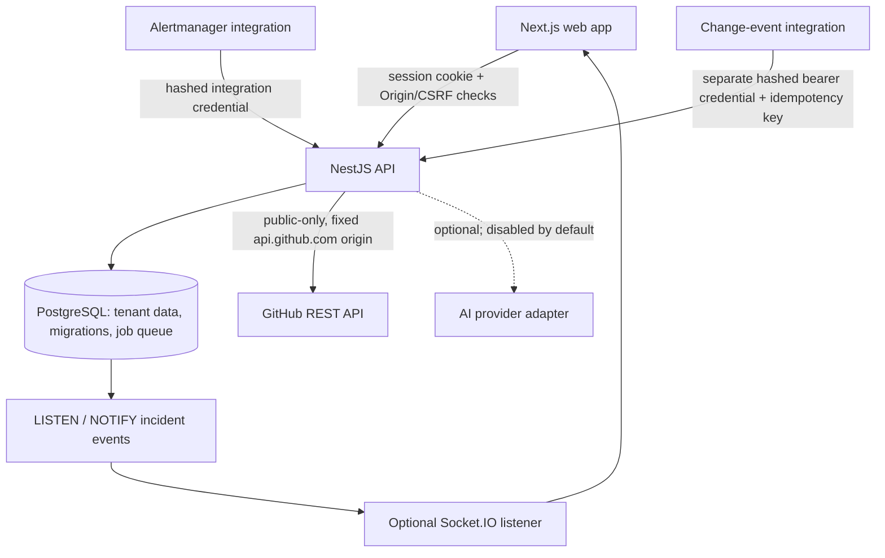

# Incident Intelligence Platform

Incident operations platform built with a NestJS API, Next.js web app, PostgreSQL, a PostgreSQL-backed job queue, optional AI assistance, GitHub issue/PR enrichment, and service/change context.

**Source status date: 2026-10-25.** This archive is a coding candidate, not a claim that the newly integrated GitHub and M10 features have passed the full project acceptance suite or are deployed.

## Current evidence status

| Area | Current status |
|---|---|
| Core M1–M9 platform | Existing implementation retained. Historical test/deployment evidence predates this final integration pass and is not re-asserted as newly verified. |
| Dependency remediation | Windows verification on the Step 1 working baseline reported clean `npm ci`, resolved `multer@2.5.0`, `zod@4.6.7`, `body-parser@2.4.0`, and `npm audit` with 0 vulnerabilities. The dependency manifests/lockfile were not changed while integrating features. Re-run audit/tests against this exact final tree before release. |
| Registration policy | Explicit API-controlled public-registration setting and read-only policy endpoint implemented; invite registration path retained. Live Render behavior remains unverified. |
| Realtime | Dedicated `REALTIME_DATABASE_URL`, disabled-by-default config, pooler guard, and public/deployed smoke scripts. Database listener and browser acceptance after these code changes remain unverified. |
| GitHub issue/PR enrichment | Backend, tenant-scoped migrations, UI, cache, rate controls and tests are included. Newly added Jest tests were not runnable in the authoring container because registry access failed. No live GitHub request/token was used. |
| M10 service/change context | Service catalog, service linkage, authenticated change-event ingestion, idempotency, temporal correlation, timeline fan-out and UI are included. New migrations `0013`/`0014` have not been applied in this authoring environment. PostgreSQL integration tests for the new code remain to be run on a disposable local database. |
| Stage 5 | Safety-guarded database backup/restore tools, smoke/simulator scripts, documentation and handoff included. A new backup/restore drill was not performed in this authoring environment. |
| AI | Disabled by default. No live provider call was made; no paid services were added. |
| Production | No commit, push, PR merge, Render deployment, hosted environment change, or production Neon access was performed. |

## Architecture



Tenant identity for browser requests is derived from the authenticated session membership, not a request-supplied organization ID. Change integration identity is derived from a stored hashed credential scoped to an integration and organization. GitHub issue/PR content is external, untrusted display data and is never sent to AI by these features.

## Getting started

Requirements: Node >= 22.12 and npm 10+ (see `.nvmrc`). Docker is optional if using a separately installed local PostgreSQL. Windows CMD and PowerShell walkthroughs are in [`docs/DEVELOPMENT.md`](docs/DEVELOPMENT.md).

```sh
npm ci
npm run setup:env
npm run services:up
npm run dev:api
# in a second terminal:
npm run dev:web
```

## Verification commands

```sh
npm run check:deps
npm run check:hygiene
npm run typecheck
npm run lint
npm test
npm run build
```

PostgreSQL-backed tests require a **disposable local** database. The integration setup fails closed for non-loopback database hosts; never use production Neon for tests or restore drills. Apply migrations to a disposable test database first, then run `npm run test:integration` with loopback-only `DATABASE_URL` and `TEST_DATABASE_URL` values.

In the authoring environment, `node --test "scripts/*.test.mjs"` passed 82/82, 16 targeted pure-logic assertions passed, the repository-hygiene scan passed for 319 source files, and a TypeScript syntax parse found no syntax diagnostics in 185 `.ts`/`.tsx` files. A full `npm ci` could not finish because the registry returned `EAI_AGAIN`; consequently, full Jest/typecheck/lint/build/integration verification **after the GitHub/M10 integration remains pending**. The report differentiates prior Windows baseline checks from checks run on this final source.

## GitHub issue enrichment and M10

- GitHub is opt-in per organization. Only allow-listed repositories and validated issue numbers are accepted. Outbound requests are fixed to `https://api.github.com`, redirects are not followed, response bodies are bounded, text/timestamps are sanitized, ETags cache responses, the process observes GitHub quota headers, and rate/circuit controls prevent request storms. No GitHub token is stored or returned. See [`docs/design/github-issue-enrichment.md`](docs/design/github-issue-enrichment.md).
- M10 provides a service catalog, incident-to-service linkage, a separate authenticated change-event webhook, idempotent event ingestion, bounded temporal correlation and incident timeline notifications. Correlation is labelled **“correlation, not proven cause.”** Invalid calendar timestamps are rejected instead of normalized. See [`docs/design/m10-service-change-context.md`](docs/design/m10-service-change-context.md) and [`docs/integrations/change-events.md`](docs/integrations/change-events.md).
- New migrations are `0013_github_issue_enrichment.sql` and `0014_service_change_context.sql`. They have not been applied to any production deployment in this work. Never edit already-applied migrations `0001`–`0012`.

## Operations and security

- Keep `REALTIME_ENABLED=false` until a dedicated direct `REALTIME_DATABASE_URL` is configured and verified. It never falls back to the ordinary query-pool URL. See [`docs/deployment/realtime-rollout.md`](docs/deployment/realtime-rollout.md).
- `npm run db:backup` and `npm run db:restore` are loopback-only by default. Restore is destructive and requires an explicit file and confirmation. Do not set a nonlocal database override for production.
- `npm run simulate:change` targets loopback by default and requires a test-only change-event integration credential at runtime; never store tokens in source or share them in chat.
- Production AI remains off unless a provider and budget are deliberately configured. No paid service was introduced.

## Security history and licensing

`NPM-AUDIT-PRE-STEP1.json` records the historical pre-fix audit. The Step 1 lockfile now targets Multer 2.5.0 and Zod 4.6.7; the attached report records the actual Windows verification and the remaining final-tree verification gap. See [`STEP1-REPORT.md`](STEP1-REPORT.md) and [`docs/security/dependency-remediation-step-1.md`](docs/security/dependency-remediation-step-1.md).

The reference project `julmtoz/ai-incident-intelligence` is listed in `LICENSES/reference-ai-incident-intelligence-MIT.txt` with an MIT notice. The reference's current repository state was not cloned or compared live as part of this work. This project's own code licence remains an owner decision; the reference notice does not license this project automatically.
