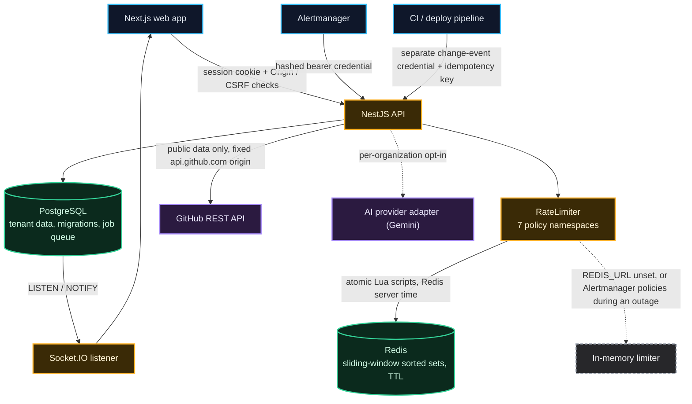
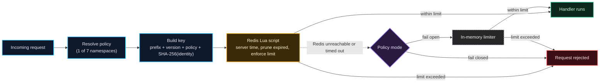
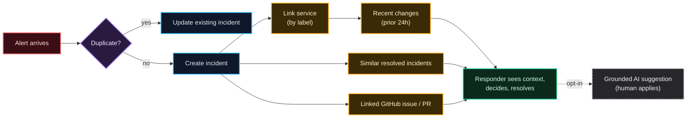

<div align="center">


# Incident Intelligence Platform

**A multi-tenant incident operations platform that turns raw alerts into context-rich, auditable incidents.**

Alert intake and deduplication · similar-incident retrieval · change correlation · GitHub context · opt-in grounded AI · Redis-backed rate limiting.

Built on a zero budget, with every safety claim backed by a test or marked as unverified.

<br>

<a href="https://incident-intelligence-free-demo.onrender.com"></a>

<br>

<a href="https://github.com/aayushtiwari307/incident-intelligence-platform/actions/workflows/ci.yml"></a>


<br>

<a href="#-live-demo"></a>
<a href="#-highlights"></a>
<a href="#-features"></a>
<a href="#-architecture"></a>
<a href="#-redis-backed-rate-limiting"></a>
<a href="#-quick-start"></a>
<a href="#-what-is-verified-and-what-is-not"></a>
<a href="#-documentation-map"></a>

<br>

<sub>Registration is invite-only (public registration is disabled in production by design). The demo runs on a free tier, so the first request after idle time can be slow.</sub>

</div>

---

## 🌐 Live demo

> [!TIP]
> **No setup needed.** Open the app, sign in with the read-only account below, and explore three synthetic incidents in different lifecycle states.

| | |
|---|---|
| 🌐 **App** | https://incident-intelligence-free-demo.onrender.com |
| 📧 **Email** | `aayushtiwari004@gmail.com` |
| 🔑 **Password** | Request the current shared Viewer password from the repository maintainer through [GitHub](https://github.com/aayushtiwari307). |
| 👁️ **Role** | **Viewer** (read-only) |

> [!NOTE]
> **Read-only demo account.** You can look at everything the Viewer role allows, but you cannot change incidents, manage the team or see integration credentials.
>
> **Registration remains invitation-only by design.** There is no public sign-up, and this demo account does not change that.

### Try it in about a minute

1. Open the app. The first load after idle time can be slow because the free-tier host has to wake up; give it a moment.
2. Sign in with the email above and the shared password provided by the repository maintainer.
3. Open the **Incidents** list and **start with these three synthetic incidents**, which cover different lifecycle states:

   | Incident | Title | State |
   |---|---|---|
   | INC-0007 | API Latency Spike | 🔴 Triggered |
   | INC-0008 | Notification Delivery Backlog | 🟡 Investigating |
   | INC-0009 | Database Connection Pool Saturation | 🟢 Resolved |

   The list also contains older records created while the platform was being tested. They are engineering verification records, apart from **INC-0002**, which is referenced in the next step.

4. Open any of the three. Each one has a **service association** (the *IIP Live Verification Service*), and the detail view includes similar-incident information. For a **populated service/change-event example**, open **INC-0002**: its service/change context shows a change event and is labelled *"correlation, not proven cause"*.
5. Open **Services** to see the service the three new incidents are attached to.

### What the Viewer account can and cannot do

| As a Viewer you can | By design you cannot |
|---|---|
| ✅ Browse incidents and open incident details | ⛔ Change an incident's status |
| ✅ See services and service/change context | ⛔ Manage the team or invitations |
| ✅ See similar-incident information | ⛔ See integration credentials or management controls |
| ✅ Use the other read-only pages | ⛔ Create an account (registration is invite-only) |

Because the demo is read-only, it does **not** show the write-side workflows live: status transitions, alert intake and deduplication, real-time updates between users, or AI suggestions. Those are covered by automated tests and recorded runs; see [what is verified, and what is not](#-what-is-verified-and-what-is-not).

### What was actually checked for this demo (2026-11-07)

| Check | Result |
|---|---|
| Viewer signs in and can open incidents, services, service/change context and similar-incident information | ✅ Checked in the UI |
| One **direct** status-transition request made with the Viewer's session | ✅ Rejected with `HTTP 403 FORBIDDEN`; the incident stayed unchanged (Triggered, version 2) |
| Team page as a Viewer | ✅ No integration secrets or management controls visible |
| Every other write endpoint probed directly with the Viewer session | ⚪ **Not done.** Only the status transition was tested this way. Role enforcement for the rest is described in the [security model](#-security-model) and is not independently claimed here |

### Demo notes

| | |
|---|---|
| 🧪 **Synthetic data only.** | The incidents are made up for demonstration. Please do not enter real personal or company information. |
| 🔑 **Shared demo account.** | The Viewer account is shared with demo visitors. The password is provided separately; never reuse it for any other account or service. |
| 📧 **Member emails are visible.** | The Team page shows member email addresses to the Viewer. This is a known, accepted trade-off for a public demo. |
| ⏳ **Typos and lockouts.** | Failed sign-ins are rate-limited per account and IP (5 attempts per 15 minutes; see [rate limiting](#-redis-backed-rate-limiting)). If you get locked out, wait and try again. |
| 🤖 **AI is off in the demo.** | AI suggestions are not enabled for the demo organization. |
| ☁️ **Free-tier host.** | The demo runs on Render Free + Neon Free as a single API instance, so expect slow first loads. |

---

## 📌 Status at a glance

> [!NOTE]
> **As of 2026-11-10, the core platform and its documented milestones are implemented, with a free-tier public demo available.** Individual verification results and remaining limitations are documented [below](#-what-is-verified-and-what-is-not). CI is green on `main`.
>
> A public, read-only demo account is available (see [Live demo](#-live-demo)).

| | |
|:-:|---|
| 🚦 | **Redis-backed rate limiting has been implemented and tested through [PR #9](https://github.com/aayushtiwari307/incident-intelligence-platform/pull/9); Redis is enabled by default in the local Docker Compose app profile through [PR #10](https://github.com/aayushtiwari307/incident-intelligence-platform/pull/10).** Redis is not configured on the public Render demo, which runs a single API instance. |
| ⚡ | **Real-time is verified locally (Docker Compose), but it is not enabled in the repository's Render configuration.** Since [PR #11](https://github.com/aayushtiwari307/incident-intelligence-platform/pull/11), `render.yaml` sets both `REALTIME_ENABLED` and `NEXT_PUBLIC_REALTIME_ENABLED` to `false` pending production acceptance. That change takes effect on Render only after deployment, and the live deployment has not been re-verified against it. The earlier backend listener check (`listening: true`) and live two-tab, same-session test on Render predate this change. |
| 🤖 | The Gemini provider is enabled in the Render server configuration, but each organization must still opt in separately. One genuine Gemini request was verified **locally with synthetic data**; **no Gemini request has been made from the public Render deployment**. |
| ⏱️ | A GitHub Actions keepalive (five-minute schedule, best-effort) was added. |

---

## 🎯 Highlights

<table>
  <tr>
    <td valign="top" width="50%">

🏢 **Multi-tenant by design:** four RBAC roles, tenant taken from the session only, and composite foreign keys so the database itself refuses cross-tenant links.

</td>
    <td valign="top" width="50%">

🚦 **Distributed rate limiting:** atomic sliding-window limits in Redis (Lua scripts, Redis server time) across seven policies, each with its own fail-open or fail-closed behaviour.

</td>
  </tr>
  <tr>
    <td valign="top" width="50%">

📨 **No message broker needed:** a durable PostgreSQL job queue (`SKIP LOCKED`, leases, fencing) and real-time updates via `LISTEN/NOTIFY` + Socket.IO.

</td>
    <td valign="top" width="50%">

🛡️ **Safe AI:** incident context is best-effort redacted before it is sent to the provider; generated output is independently schema- and provenance-validated (verbatim-quote citations) and applied only by a human.

</td>
  </tr>
  <tr>
    <td valign="top" colspan="2">

🧪 **Evidence over claims:** CI, 324 API tests and 21 dedicated Redis tests, a container smoke test, a real Alertmanager sender and a backup/restore drill, each marked verified or unverified below.

</td>
  </tr>
</table>

---

## ✨ Features

| Capability | What it does |
|---|---|
| 🏢 **Multi-tenant workspaces** | Organizations with four roles (`viewer` → `responder` → `admin` → `owner`), email-bound single-use invitations, and invite-only registration in production. Tenant identity always comes from the authenticated session, never from the request. |
| 🔐 **Hardened auth** | `scrypt` password hashing, opaque revocable sessions stored hashed, `HttpOnly` `__Host-` cookie, CSRF and browser-`Origin` checks, and [Redis-backed rate limits](#-redis-backed-rate-limiting) on login and registration. |
| 🚦 **Distributed rate limiting** | Seven policies enforced by atomic Redis sliding windows, with in-memory limiting when Redis is not configured. Covers login, registration, Alertmanager intake, failed webhook authentication and AI requests. |
| 🔄 **Incident lifecycle** | Validated status transitions, optimistic concurrency (stale writes get `409`), and an append-only, audited timeline of every change. |
| 🚨 **Alertmanager intake** | `POST /api/v1/integrations/alertmanager` accepts Prometheus Alertmanager webhook v4, authenticates with a hashed bearer credential (rotate / revoke supported), and **deduplicates** by integration + fingerprint + `startsAt`. |
| 🔎 **Similar incidents (no AI)** | PostgreSQL weighted full-text search over resolved incidents, tenant-scoped, with matched terms shown. Includes a reproducible evaluation harness. |
| 🤖 **Grounded AI suggestions (opt-in)** | Gemini 3.5 Flash-Lite provider (a mock provider is used in tests), enabled server-side by configuration, with each organization opting in separately. The model sees the incident plus at most five similar resolved incidents, best-effort redacted. Output is validated against a strict schema and must cite sources by alias with verbatim quotes (provenance check). Suggestions are rate-limited and quota-limited, and only a human can apply them. |
| 🧭 **Service and change context** | Per-organization service catalog, a separate change-event webhook (idempotent), and an incident panel listing changes from the 24 hours before the incident, labelled *"correlation, not proven cause."* |
| 🐙 **GitHub issue/PR enrichment** | Opt-in per organization with a repository allow-list. Public data only, fixed `api.github.com` origin, no redirects, bounded responses, ETag caching, quota-aware rate limiting and a circuit breaker. No GitHub token is stored. |
| ⚡ **Real-time updates** | Socket.IO fed by PostgreSQL `LISTEN/NOTIFY`. The handshake checks the session cookie and `Origin`; only organization-filtered messages are broadcast. The frontend defaults to off and enables real-time only when `NEXT_PUBLIC_REALTIME_ENABLED` is exactly `"true"`; the API listener needs `REALTIME_ENABLED=true` and a dedicated direct (non-pooled) PostgreSQL connection through `REALTIME_DATABASE_URL`. Verified locally with Docker Compose; the repository's `render.yaml` currently sets both flags to `false`. `/health/ready` checks normal database readiness only and does not verify that the real-time listener is connected or healthy, so listener connectivity must be verified separately. |
| 🗃️ **Durable job queue** | PostgreSQL-backed and independent of Redis or a separate message broker: `FOR UPDATE SKIP LOCKED`, leases with fencing, retries with backoff, and poison-job isolation so one bad job cannot starve healthy ones. |
| 🖥️ **Control Room UI** | A dark, keyboard-friendly interface with a sidebar, status progress track, severity indicators and instructive empty states. Deployed on the live demo. |

---

## 🏗 Architecture



### Rate-limit decision flow



### From alert to context



> **Design stance:** a modular monolith with a background worker. PostgreSQL is the single source of truth for application data and the background job queue. There is **no ORM** (handwritten SQL with `pg` and numbered, never-edited migrations). Redis is **enabled by default in the Docker Compose `app` profile** for distributed rate limiting; standalone API processes use the in-memory fallback when `REDIS_URL` is unset. **No paid services** are required for local development.

---

## 🚦 Redis-backed rate limiting

> [!IMPORTANT]
> **Status: implemented, tested, and merged through [PR #9](https://github.com/aayushtiwari307/incident-intelligence-platform/pull/9). Redis was enabled by default in the local Docker Compose `app` profile through [PR #10](https://github.com/aayushtiwari307/incident-intelligence-platform/pull/10).**

The API uses one asynchronous `RateLimiter` interface (`consume()`, `peek()`, `reset()`) for both process-local and distributed limiting. The Docker Compose `app` profile defaults `REDIS_URL` to `redis://redis:6379` and starts the API only after both PostgreSQL and Redis report healthy. This enables shared rate-limit state across API processes in the local Compose stack. For a non-Compose API process, leaving `REDIS_URL` unset selects the in-memory `SlidingWindowLimiter`.

### Policies

| # | Policy | Scope | Limit | Window | If Redis is unavailable |
|:-:|---|---|---:|---:|---|
| 1 | **Login by IP** | Per IP | 100 | 15 min | 🔒 **Fail closed** |
| 2 | **Login by account** | Per account + IP | 5 | 15 min | 🔒 **Fail closed** |
| 3 | **Registration by IP** | Per IP | 10 | 1 hour | 🔒 **Fail closed** |
| 4 | **Alertmanager by IP** | Per IP | 600 | 1 min | 🔓 **Fail open** → in-memory fallback (process-local limits still enforced) |
| 5 | **Webhook failed authentication** | Failed attempts | 20 | 5 min | 🔒 **Fail closed** |
| 6 | **Alertmanager integration** | Per integration | 300 | 1 min | 🔓 **Fail open** → in-memory fallback (process-local limits still enforced) |
| 7 | **AI requests by user** | Per user, global across organizations | 5 | 10 min | 🔒 **Fail closed** |

A valid Alertmanager integration is never rejected solely because the failed-authentication preflight cannot reach Redis; invalid credentials still fail closed. Registration uses a more permissive 10,000/hour override in the test environment only.

### Engineering details

| Concern | How it works |
|---|---|
| ⚛️ **Atomic sliding window** | Requests are recorded in Redis Sorted Sets, one member per unique request. Lua scripts remove expired entries and enforce the policy counter in a single atomic call, so concurrent API instances cannot race each other. The scripts back `consume()`, `peek()` and `reset()`. |
| 🕒 **Redis server time** | The scripts take their timestamp from Redis itself, not from the application host, so clock skew between API instances cannot distort a window. |
| 🎚️ **Policy-specific failure mode** | Security-sensitive entry points (login, registration, failed webhook authentication, AI requests) **fail closed**: an outage cannot become a way around the limit. The two Alertmanager policies (by IP, by integration) **fail open** to the in-memory limiter during a Redis outage, so alert delivery keeps working. That fallback still enforces limits, but only per API process, not across instances. |
| ⏱️ **Bounded connection handling** | TCP connect is capped at 1 s. The full Redis handshake and each dispatched command have separate 5 s absolute deadlines. Commands waiting to be written have a 1 s queue timeout. A timed-out operation destroys its client, offline queuing is disabled, and the next request reconnects after a short cooldown. Redis clients are closed on API shutdown. |
| 🕵️ **Privacy-safe keys** | Key = fixed application prefix + version + one of the seven policy namespaces + a **SHA-256 hash** of the identity. Raw email addresses and IP addresses never appear in Redis keys. Every key has a TTL and expires after its policy window. |
| 👤 **AI limits follow the user** | The AI limiter is keyed on the user's **global user ID**, so switching organizations does not reset the allowance. |
| ♻️ **Successful-login reset** | A successful login resets that account's login counter, so legitimate users are not locked out by earlier typos. Failed attempts keep counting. |

<details>
<summary><b>Run it locally</b> (Compose defaults to Redis)</summary>

<br>

Start PostgreSQL, Redis and the API through the app profile. The API waits for both dependencies to become healthy. Redis is exposed on loopback at `127.0.0.1:6381`; Compose containers use `redis://redis:6379`:

```bash
docker compose --profile app up -d postgres redis api
```

For an API process running directly on the host, configure:

```bash
# PowerShell
$env:REDIS_URL="redis://127.0.0.1:6381"

# CMD
set REDIS_URL=redis://127.0.0.1:6381

# Bash
export REDIS_URL="redis://127.0.0.1:6381"
```

A standalone API process with `REDIS_URL` unset uses in-memory limiting. Run the dedicated Redis test suite with:

```bash
npm run test:redis -w @platform/api   # needs Redis 7 and a loopback TEST_DATABASE_URL
```

</details>

> **Scope of the claim.** CI runs the dedicated Redis suite against Redis 7. The local two-process Compose verification is recorded in the verification section. The Render demo remains a single API instance with no Redis/Valkey service configured; production multi-instance behaviour has not been verified.

---

## 🧰 Tech stack

| Layer | Choice |
|---|---|
| 🖥️ **Web** | Next.js 16 (App Router), React 19, TypeScript |
| ⚙️ **API** | NestJS 11 with framework-free handlers behind thin controllers |
| 🗄️ **Data** | PostgreSQL 16, raw SQL via `pg`, 14 numbered migrations |
| 🚦 **Rate limiting** | Redis 7 sliding window (atomic Lua scripts; enabled by default in the Compose `app` profile), with an in-memory fallback for standalone API processes |
| ⚡ **Real-time** | Socket.IO 4.8 over PostgreSQL `LISTEN/NOTIFY` |
| ✅ **Validation** | Zod 4, shared between API and web (`packages/shared`) |
| 🤖 **AI (optional)** | Gemini 3.5 Flash-Lite adapter with schema-validated, citation-checked output |
| 🧪 **Testing** | Jest, real-PostgreSQL and real-Redis integration tests, Node test runner for scripts |
| 📦 **Delivery** | Docker Compose, Caddy single-origin proxy, GitHub Actions (CI + best-effort keepalive) |
| ☁️ **Hosting (demo)** | Render Free + Neon Free (₹0) |

---

## 🚀 Quick start

Requirements: **Node 22+**, npm 10+, Docker (for the local PostgreSQL). Windows CMD and PowerShell walkthroughs are in [`docs/DEVELOPMENT.md`](docs/DEVELOPMENT.md).

```bash
npm ci
npm run setup:env      # creates a local .env with generated secrets
npm run services:up    # starts PostgreSQL on 127.0.0.1:5545
npm run migrate        # applies migrations 0001-0014
npm run dev:api        # API on http://127.0.0.1:3001
# in a second terminal
npm run dev:web        # web on http://127.0.0.1:3000
```

> [!WARNING]
> Open **`http://127.0.0.1:3000`**. The session cookie is host-only. Use `127.0.0.1` consistently instead of switching between `localhost` and `127.0.0.1`; a cookie set for one hostname is not sent to the other.

The Quick Start commands above run the API directly on the host, so it uses in-memory rate limiting unless `REDIS_URL` is configured. The Docker Compose `app` profile enables Redis-backed distributed limiting by default. See [Run it locally](#-redis-backed-rate-limiting) for the Compose setup.

**Try the integrations locally** (loopback only, tokens are created in the Team page and never committed):

```bash
npm run simulate:alertmanager   # fire sample alerts at the Alertmanager webhook
npm run simulate:change         # send a sample deploy/change event
```

---

## 🧪 Testing

```bash
npm run check:deps && npm run check:hygiene
npm run typecheck && npm run lint
npm test                    # unit tests (scripts, shared, API, web)
npm test -w @platform/api   # API unit tests only, with Redis-specific tests excluded
npm run test:integration    # real PostgreSQL, loopback only
npm run test:redis -w @platform/api  # dedicated real-Redis tests; Redis 7 and loopback TEST_DATABASE_URL must be available
npm run build
npm run smoke:stack         # against the running container stack
```

> `smoke:stack` also checks real-time. For a local run, set `REALTIME_ENABLED=true` in your `.env`, provide a dedicated direct PostgreSQL URL through `REALTIME_DATABASE_URL`, and rebuild/recreate the API and web services with `docker compose --profile app up -d --build api web` first; otherwise its real-time checks fail by design. Compose maps `REALTIME_ENABLED` to the web build flag `NEXT_PUBLIC_REALTIME_ENABLED`, which is applied at build time, so the web service must be rebuilt after changing it.

Integration tests **fail closed** unless the database host is loopback, so they cannot touch a hosted database. CI also builds the full container stack, smoke-tests HTTP and WebSocket behaviour (including a negative control that must fail when real-time is off), and repeats the smoke test through the single-origin proxy.

---

## ✅ What is verified, and what is not

Every claim here is tied to a date and a kind of evidence. Nothing is rounded up.

### Redis rate limiting (PR #9) · final verified results

| Check | Result |
|---|---:|
| Redis test suites | ✅ 3/3 passed |
| Redis tests | ✅ 21/21 passed |
| Full API test suites | ✅ 31/31 passed |
| Full API tests | ✅ 324/324 passed |
| API typecheck | ✅ Passed |
| API build | ✅ Passed |

### Local Compose distributed check (2026-11-10)

Two independent API containers shared the same Compose Redis service. A manual HTTP run sent 200 `POST /api/auth/login` requests, split evenly between the two API processes. Each request used a unique synthetic account and invalid credentials, so a `401` indicates that it passed the login-IP rate limiter and reached authentication.

| Check | Result |
|---|---|
| API processes | 2 independent containers using `redis://redis:6379` |
| Requests | 200 total; 100 sent to each API |
| API 1 responses | 50 `401`, 50 `429` |
| API 2 responses | 50 `401`, 50 `429` |
| Total responses | 100 `401`, 100 `429` |
| Shared Redis counter | 1 login-IP sorted-set key with 100 members |
| Unexpected responses/errors | 0 |
| Cleanup | Temporary API container and test Redis key removed |

This was a manual local verification, not a checked-in automated test. It demonstrates shared rate-limit enforcement in the local Compose environment; it does not establish production deployment behaviour.

### Local real-time verification (PR #11, Docker Compose)

> [!NOTE]
> These are **local Docker Compose results only**. They are not production or Render results, and they do not establish production real-time behaviour.

PR #11 (`373de1d`, merged into `main`) aligned real-time configuration across environments: the frontend defaults to off and is enabled only when `NEXT_PUBLIC_REALTIME_ENABLED` is explicitly `"true"`; `apps/web/.env.example` defaults it to `false`; Docker Compose passes `REALTIME_ENABLED` into the web build as `NEXT_PUBLIC_REALTIME_ENABLED` (the web Dockerfile accepts it as a build argument); the `REALTIME_DATABASE_URL` comment states that a dedicated direct PostgreSQL connection is required when `REALTIME_ENABLED=true`; and `render.yaml` sets both `REALTIME_ENABLED` and `NEXT_PUBLIC_REALTIME_ENABLED` to `false`. The `render.yaml` change takes effect on Render only after deployment; the live deployment has not been updated or verified here.

| Check | Command | Result |
|---|---|---:|
| API configuration tests | `npm test -w @platform/api -- --runInBand src/config/env.test.ts` | ✅ 47/47 passed |
| Stack smoke test | `npm run smoke:stack` | ✅ 20/20 checks passed |

The 20 smoke checks included authenticated Socket.IO connection, REST-to-real-time event delivery, foreign-`Origin` rejection, cross-organization event isolation, and socket closure after session logout.

**Real-time latency and isolation benchmark** (`node scripts/bench-realtime-latency.mjs 100 3`): three sequential rounds of 100 incident events each in organization A, while organization B received 20 of its own test events.

| Metric | Result |
|---|---:|
| Organization A events received | 300/300 |
| Organization B events received | 20/20 |
| Timeouts | 0 |
| p50 create-to-push latency | 19.7 ms |
| p95 create-to-push latency | 26.4 ms |
| p99 create-to-push latency | 34.6 ms |
| Organization A events received by B | 0/300 |
| Organization B events received by A | 0/20 |

The benchmark was **sequential**, not a concurrent-load test. Its create-to-push timing includes REST request handling and database processing as well as notification delivery, so it is **not** pure WebSocket transport latency.

**Readiness limitation.** `/health/ready` checks normal database readiness. It does **not** verify that the real-time `LISTEN/NOTIFY` listener is connected or healthy; listener connectivity must be verified separately.

### Platform-wide evidence

| Area | Evidence | Status |
|---|---|---|
| 🚦 **Redis rate limiting** | Implemented, tested and merged through [PR #9](https://github.com/aayushtiwari307/incident-intelligence-platform/pull/9) into `main`; Redis defaults in the local Compose `app` profile through [PR #10](https://github.com/aayushtiwari307/incident-intelligence-platform/pull/10). The local two-process check is documented above. No Redis/Valkey service is configured for the single-instance Render demo; production multi-instance behaviour is not established. | ✅ Verified in tests · demo not Redis-backed |
| 🧩 **Whole platform** | Windows run on 2026-10-25 at `d89f800`: clean `npm ci`, typecheck, lint, **537 unit/script tests**, **271 real-PostgreSQL integration tests (21 suites)**, production build. These counts are from that earlier commit and are not directly comparable to the API-only figures above. | ✅ Verified locally |
| 📦 **Container stack** | `smoke:stack` passed **20/20** checks against rebuilt images, including real-time authentication, delivery, tenant isolation and logout. | ✅ Verified locally |
| ☁️ **Demo deployment** | Render Free + Neon at https://incident-intelligence-free-demo.onrender.com; `/health/live` and `/health/ready` return OK. `/health/ready` checks normal database readiness only; it does **not** verify the real-time `LISTEN/NOTIFY` listener, which must be verified separately. | ✅ Live runtime verified |
| 👁️ **Public demo access** | A Viewer account created through the normal Team invitation flow, with three synthetic incidents (INC-0007 to INC-0009). Viewer read access was checked in the UI; one direct status-transition request with the Viewer session returned `403 FORBIDDEN` and left the incident unchanged; the Team page showed no integration secrets or management controls. Other write endpoints were **not** individually probed with the Viewer session. Details in [Live demo](#-live-demo). | 🟡 Partially verified (2026-11-07) |
| ⏱️ **Keepalive workflow** | A GitHub Actions workflow is scheduled every five minutes to ping the Render service. Scheduled runs are **best-effort**: GitHub may delay or skip them. The first **manual** run received HTTP 200 from Render; reliable **recurring scheduled** execution has not been verified. | 🟡 Manual run verified · scheduled runs unverified |
| 🔁 **Continuous integration** | Latest run on `main` is green. | ✅ Passing |
| 🛡️ **Dependency audit** | `npm audit` reported **0 vulnerabilities** on the 2026-10-25 tree (547 packages). | ✅ Clean on 2026-10-25 |
| 🐙 **GitHub enrichment** | Repository/PR association and the API/UI paths are implemented and tested. Live PR/issue detail retrieval remains unverified: the earlier live attempt returned `rate_limited`. | 🟡 Live detail retrieval unverified |
| 🧭 **Service and change context** | Live change event `live-check-001` appeared in Incident #3's service/change context, and the service association and event details persisted after refresh. Correlation is contextual evidence only; causation is **not** proven. | ✅ Live persistence verified |
| 🔑 **Registration policy** | Invite-only default in production, covered by code and tests. | 🟡 Not separately checked on the live service |
| ⚡ **Real-time** | Integration tests and the 20/20 container smoke test cover authentication, delivery, tenant isolation and logout, and the [local real-time verification](#local-real-time-verification-pr-11-docker-compose) above adds configuration tests and a 3 × 100-event two-organization benchmark. Earlier, on Render, backend listener startup was verified (`listening: true`) and a live **two-tab** test (Triggered → Acknowledged in one tab updated the other without refresh) was run in the **same browser session**; there is **no independent-user verification**. Since PR #11, `render.yaml` sets real-time to `false`, which takes effect on Render only after deployment. Production reconnect/resynchronization and multi-user acceptance have **not** been verified. | ✅ Verified locally · 🟡 Render disabled in configuration pending acceptance · production unverified |
| 🚨 **Alertmanager intake** | 8 synthetic live scenarios passed (including 5 concurrent deliveries → 1 incident + 4 duplicates). A real `prom/alertmanager` container then delivered an authenticated alert to the deployed app and created Incident #6. Deduplication and resolution were verified with the synthetic scenarios. | ✅ Verified |
| 🤖 **Grounded AI (Gemini)** | Gemini 3.5 Flash-Lite provider. One genuine request was run **locally** on a synthetic incident; it returned source-grounded suggestions that passed the existing validation flow. Provider tests passed 5/5. The provider is enabled in the Render server configuration, but organization-level opt-in is separate. An OpenAI adapter exists with unit tests only. | 🟡 Verified locally on synthetic data · **no Gemini request has been made from the public Render deployment** |
| 💾 **Backup / restore** | Guarded scripts and focused safety tests; a disposable local PostgreSQL backup/restore verification passed on 2026-11-02. | ✅ Verified locally, not a production restore drill |

<details>
<summary><b>Retrieval quality</b></summary>

<br>

On a *synthetic, single-author* corpus of 32 resolved incidents, weighted English full-text search scored Recall@5 **0.82** against **0.60** for a plain full-text baseline (+0.22; paired bootstrap interval +0.09 to +0.34). The point estimate met the pre-declared +0.10 gate, but the interval's lower bound does not, and the corpus is not production data. Treat it as a regression guard, not proof of real-world relevance. Protocol and corpora are in [`docs/verification/`](docs/verification/).

</details>

---

## 🔒 Security model

| | |
|---|---|
| 🏢 **Tenancy:** | the organization comes from session membership. Tenant tables use composite foreign keys, and cross-tenant reads return `404`. |
| 🛂 **Authorization:** | enforced in the API by role; the browser is never trusted. |
| 🚦 **Abuse protection:** | seven rate-limit policies cover login, registration, Alertmanager intake, failed webhook authentication and AI requests. Auth-sensitive policies fail closed, and Redis keys contain only hashed identities. See [Redis-backed rate limiting](#-redis-backed-rate-limiting). |
| 🪝 **Webhooks:** | bearer credentials are shown once and stored only as hashes. Alert and change credentials are different kinds and cannot be swapped. The body is read only after the credential is verified and is size-capped. |
| 🌍 **Outbound calls:** | GitHub requests go only to a fixed origin, with no redirects, response-size caps and sanitised remote text. External content is never sent to AI. |
| 🤖 **AI safety:** | opt-in per organization, a per-user rate limit and a daily quota. Incident context is best-effort redacted before it is sent to the provider. Generated output is independently validated: a strict output schema, and citations that must quote the sent source verbatim. Changes are applied only by a human. Redaction is best-effort, not a guarantee. Citations prove *where* text came from, not that it is *correct*, and the UI says to verify. |
| 🛠️ **Operations:** | migrations are never edited after being applied, destructive scripts are loopback-only, and the repository hygiene check blocks secret-looking files. |

---

## 🎓 Engineering concepts this project demonstrates

| | |
|---|---|
| ⚛️ **Atomic sliding-window rate limiting:** Redis Lua scripts with server-side time, so concurrent instances share one consistent window. | 🎚️ **Fail-open vs fail-closed design:** the failure mode is chosen per policy, based on what an outage would put at risk. |
| 🔄 **Optimistic concurrency control:** version checks return `409` instead of silently overwriting. | ♻️ **Idempotency:** webhook deduplication and unique keys make retries safe. |
| 🔐 **Row-level locking:** `FOR UPDATE`, `FOR KEY SHARE` and `SKIP LOCKED` for races and queue claiming. | 🪪 **Lease fencing:** a stale worker cannot commit a job it no longer owns. |
| 🏢 **Composite foreign keys for multi-tenancy:** the database itself refuses cross-tenant links. | 📡 **LISTEN/NOTIFY:** push updates without a message broker. |
| 🗂️ **Conditional HTTP caching (ETag)** and a **circuit breaker** for an external API. | 🧾 **Provenance checking for LLM output:** verbatim-quote validation instead of trusting the model. |
| 📊 **Bootstrap confidence intervals:** honest evaluation on a small corpus. | |

---

## 🗺 Project status

**Implemented**

- [x] Multi-tenant auth, organizations, four roles and email-bound invitations
- [x] Incident lifecycle with audit timeline and optimistic concurrency
- [x] Durable PostgreSQL job queue
- [x] Real-time updates (Socket.IO over `LISTEN/NOTIFY`); configuration, smoke checks, event delivery and two-organization isolation verified locally. Render real-time remains disabled in repository configuration pending production acceptance and deployment
- [x] Alertmanager intake with deduplication
- [x] Similar-incident retrieval, with an evaluation harness
- [x] Opt-in grounded AI suggestions (Gemini provider)
- [x] GitHub issue/PR enrichment (association and API/UI paths)
- [x] Service catalog and change-event context
- [x] Redis-backed rate limiting and dedicated Redis tests ([PR #9](https://github.com/aayushtiwari307/incident-intelligence-platform/pull/9))
- [x] Redis enabled by default in the local Docker Compose `app` profile ([PR #10](https://github.com/aayushtiwari307/incident-intelligence-platform/pull/10))
- [x] Real-time configuration aligned across environments: frontend defaults to off, Compose and Dockerfile pass the build flag, `render.yaml` sets real-time to `false` ([PR #11](https://github.com/aayushtiwari307/incident-intelligence-platform/pull/11))
- [x] Control Room UI
- [x] Free-tier deployment on Render + Neon, best-effort keepalive, and a public read-only Viewer demo

**Still open**

- [ ] Successful live GitHub PR/issue detail retrieval
- [ ] Independent-user real-time verification (only a same-session two-tab test so far)
- [ ] Production real-time reconnect/resynchronization and multi-user acceptance, followed by enabling real-time on Render after deployment
- [ ] Verified recurring scheduled keepalive runs (only a manual run so far)

---

## 📚 Documentation map

| Topic | Where |
|---|---|
| 💻 **Local development (Windows and Unix)** | [`docs/DEVELOPMENT.md`](docs/DEVELOPMENT.md) |
| 🧱 **Architecture decisions** | [`docs/decisions/`](docs/decisions/) |
| 🚨 **Alertmanager webhook** | [`docs/integrations/alertmanager.md`](docs/integrations/alertmanager.md) |
| 🔀 **Change-event webhook** | [`docs/integrations/change-events.md`](docs/integrations/change-events.md) |
| 🤖 **Gemini grounded suggestions** | [`docs/integrations/gemini-ai-suggestions.md`](docs/integrations/gemini-ai-suggestions.md) |
| 🐙 **GitHub enrichment design** | [`docs/design/github-issue-enrichment.md`](docs/design/github-issue-enrichment.md) |
| 🧭 **Service and change context design** | [`docs/design/m10-service-change-context.md`](docs/design/m10-service-change-context.md) |
| ☁️ **Free deployment guide** | [`docs/deployment/m6-free-deployment.md`](docs/deployment/m6-free-deployment.md) |
| ⚡ **Real-time rollout** | [`docs/deployment/realtime-rollout.md`](docs/deployment/realtime-rollout.md) |
| ✅ **Verification records** | [`docs/verification/`](docs/verification/) |
| 🔒 **Security and dependency notes** | [`docs/security/`](docs/security/) |
| 🧠 **Project memory and handoff** | [`PROJECT_MEMORY.md`](PROJECT_MEMORY.md), [`docs/HANDOFF.md`](docs/HANDOFF.md) |

---

## 📄 License and attribution

Released under the [MIT License](LICENSE). Third-party notices are in [`THIRD_PARTY_NOTICES.md`](THIRD_PARTY_NOTICES.md).

<div align="center">

<sub>Built by <a href="https://github.com/aayushtiwari307">Aayush Tiwari</a> · Zero budget, zero hand-waving.</sub>


</div>
