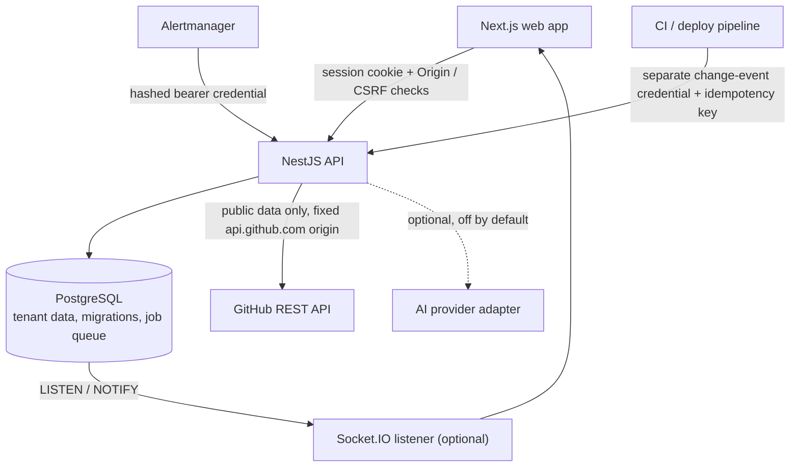
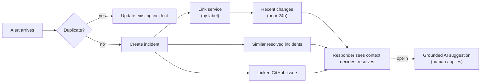

<div align="center">

# 🚨 Incident Intelligence Platform

**A multi-tenant incident operations platform that turns raw alerts into context-rich, auditable incidents.**
Alert intake and deduplication · similar-incident retrieval · change correlation · GitHub context · opt-in grounded AI.
Built on a zero budget, with every safety claim backed by a test or marked as unverified.

[](https://github.com/aayushtiwari307/incident-intelligence-platform/actions/workflows/ci.yml)


[Features](#-features) · [Architecture](#-architecture) · [Quick start](#-quick-start) · [Evidence](#-what-is-verified-and-what-is-not) · [Docs](#-documentation-map)

<!-- Add a hero screenshot or GIF here, e.g. docs/assets/incident-detail.png -->
<!-- Add your live demo link here once the M10 build is redeployed -->

</div>

---

## 📌 Status at a glance

> **Code-complete through Milestone 10** (as of 2026-10-25). The public demo runs the M1–M9 build on Render Free + Neon.
> GitHub enrichment and M10 service/change context are merged to `main` but **not yet deployed**, and a full test run on the
> final tree has **not yet been recorded**. The [evidence table](#-what-is-verified-and-what-is-not) below says exactly what is proven.

---

## ✨ Features

| | Capability | What it does |
|---|---|---|
| 🏢 | **Multi-tenant workspaces** | Organizations with four roles (`viewer` → `responder` → `admin` → `owner`), email-bound single-use invitations, and invite-only registration in production. Tenant identity always comes from the authenticated session, never from the request. |
| 🔐 | **Hardened auth** | `scrypt` password hashing, opaque revocable sessions stored hashed, `HttpOnly` `__Host-` cookie, CSRF and browser-`Origin` checks, per-route rate limits. |
| 📟 | **Incident lifecycle** | Validated status transitions, optimistic concurrency (stale writes get `409`), and an append-only, audited timeline of every change. |
| 🔔 | **Alertmanager intake** | `POST /api/v1/integrations/alertmanager` accepts Prometheus Alertmanager webhook v4, authenticates with a hashed bearer credential (rotate / revoke supported), and **deduplicates** by integration + fingerprint + `startsAt`. |
| 🔎 | **Similar incidents (no AI)** | PostgreSQL weighted full-text search over resolved incidents, tenant-scoped, with matched terms shown. Includes a reproducible evaluation harness. |
| 🤖 | **Grounded AI suggestions (opt-in)** | Off by default. When enabled, the model sees the incident plus at most five similar resolved incidents and must cite them by alias with verbatim quotes. Output is schema-validated, quota-limited, redacted on the way out, and only a human can apply it. |
| 🧩 | **Service and change context (M10)** | Per-organization service catalog, a separate change-event webhook (idempotent), and an incident panel listing changes from the 24 hours before the incident, labelled *"correlation, not proven cause."* |
| 🐙 | **GitHub issue/PR enrichment** | Opt-in per organization with a repository allow-list. Public data only, fixed `api.github.com` origin, no redirects, bounded responses, ETag caching, quota-aware rate limiting and a circuit breaker. No GitHub token is stored. |
| ⚡ | **Real-time updates** | Socket.IO fed by PostgreSQL `LISTEN/NOTIFY`. The handshake checks session cookie and `Origin`; only organization-filtered messages are broadcast. Disabled by default until a direct (non-pooled) database URL is configured. |
| 🛠️ | **Durable job queue** | PostgreSQL-backed (no Redis): `FOR UPDATE SKIP LOCKED`, leases with fencing, retries with backoff, and poison-job isolation so one bad job cannot starve healthy ones. |

---

## 🏗 Architecture



### From alert to context



**Design stance:** a modular monolith with a background worker. PostgreSQL is the single source of truth. There is **no ORM**
(handwritten SQL with `pg` and numbered, never-edited migrations), **no Redis** and **no paid service**.

---

## 🧰 Tech stack

| Layer | Choice |
|---|---|
| Web | Next.js 16 (App Router), React 19, TypeScript |
| API | NestJS 11 with framework-free handlers behind thin controllers |
| Data | PostgreSQL 16, raw SQL via `pg`, 14 numbered migrations |
| Real-time | Socket.IO 4.8 over PostgreSQL `LISTEN/NOTIFY` |
| Validation | Zod 4, shared between API and web (`packages/shared`) |
| Testing | Jest, real-PostgreSQL integration tests, Node test runner for scripts |
| Delivery | Docker Compose, Caddy single-origin proxy, GitHub Actions |
| Hosting (demo) | Render Free + Neon Free (₹0) |

---

## 🚀 Quick start

Requirements: **Node 22+**, npm 10+, Docker (for the local PostgreSQL). Windows CMD and PowerShell walkthroughs are in
[`docs/DEVELOPMENT.md`](docs/DEVELOPMENT.md).

```bash
npm ci
npm run setup:env      # creates a local .env with generated secrets
npm run services:up    # starts PostgreSQL on 127.0.0.1:5545
npm run migrate        # applies migrations 0001-0014
npm run dev:api        # API on http://127.0.0.1:3001
# in a second terminal
npm run dev:web        # web on http://127.0.0.1:3000
```

> ⚠️ Open **`http://127.0.0.1:3000`**, not `localhost`. The session cookie is `SameSite=Lax`, so the two hosts are different
> sites and sign-in would appear to work and then fail with `401`.

**Try the integrations locally** (loopback only, tokens are created in the Team page and never committed):

```bash
npm run simulate:alertmanager   # fire sample alerts at the Alertmanager webhook
npm run simulate:change         # send a sample deploy/change event
```

---

## 🧪 Testing

```bash
npm run check:deps && npm run check:hygiene
npm run typecheck && npm run lint
npm test                    # unit tests (scripts, shared, API, web)
npm run test:integration    # real PostgreSQL, loopback only
npm run build
```

Integration tests **fail closed** unless the database host is loopback, so they cannot touch a hosted database. CI also builds
the full container stack, smoke-tests HTTP and WebSocket behaviour (including a negative control that must fail when real-time is
off), and repeats the smoke test through the single-origin proxy.

---

## ✅ What is verified, and what is not

Every claim here is tied to a date and a kind of evidence. Nothing is rounded up.

| Area | Evidence | Status |
|---|---|---|
| Core platform M1–M9 | Windows run on 2026-10-24: typecheck, lint, **445 unit tests**, **257 real-PostgreSQL integration tests**, API and web builds all passed | ✅ Verified locally |
| Demo deployment | Render Free + Neon, `/`, `/health/live`, `/health/ready` returned HTTP 200 on 2026-10-24 (M1–M9 build) | ✅ Live checks passed |
| Continuous integration | CI #18 green on `3fdfb63`. Later commits are CI fixes and the PR #7 merge | 🟡 Re-confirm the latest run on `main` |
| Dependency audit | Pre-merge baseline: clean `npm ci`, `npm audit` reported 0 vulnerabilities | 🟡 Re-run on the final tree |
| GitHub enrichment (0013) | Code, mocked-network unit tests, one real-PostgreSQL tenant-boundary test | 🟡 Implemented, no full-tree run recorded, **no live GitHub call** |
| Service and change context (0014) | Code plus a real-PostgreSQL integration suite (5 tests) | 🟡 Implemented, no full-tree run recorded |
| Registration policy | Invite-only default in production, covered by code and tests | 🟡 Not yet checked on the live Render service |
| Real-time | Server and client code with integration tests | ⬜ Off on the demo; **two-browser acceptance not done** |
| Alertmanager intake | Integration tests and a local simulator | ⬜ Never tested against a real Alertmanager |
| Grounded AI | Tested with fake providers and an OpenAI adapter's unit tests | ⬜ **No live provider call has ever been made**; AI is off on the demo |
| Backup / restore | Guarded scripts with unit tests | ⬜ Drill not yet performed |

**Retrieval quality (M8).** On a *synthetic, single-author* corpus of 32 resolved incidents, weighted English full-text search
scored Recall@5 **0.82** against **0.60** for a plain full-text baseline (+0.22; paired bootstrap interval +0.09 to +0.34).
The point estimate met the pre-declared +0.10 gate, but the interval's lower bound does not, and the corpus is not
production data. Treat it as a regression guard, not proof of real-world relevance. Protocol and corpora are in
[`docs/verification/`](docs/verification/).

---

## 🔒 Security model

- **Tenancy:** the organization comes from session membership. Tenant tables use composite foreign keys, and cross-tenant reads return `404`.
- **Authorization:** enforced in the API by role; the browser is never trusted.
- **Webhooks:** bearer credentials are shown once and stored only as hashes. Alert and change credentials are different kinds and cannot be swapped. The body is read only after the credential is verified and is size-capped.
- **Outbound calls:** GitHub requests go only to a fixed origin, with no redirects, response-size caps and sanitised remote text. External content is never sent to AI.
- **AI safety:** opt-in per organization, daily quota, outbound redaction, citations that must quote the sent source verbatim, strict output schema, and human-applied changes. Citations prove *where* text came from, not that it is *correct*, and the UI says to verify.
- **Operations:** migrations are never edited after being applied, destructive scripts are loopback-only, and the repository hygiene check blocks secret-looking files.

---

## 🎓 Engineering concepts this project demonstrates

- **Optimistic concurrency control** — version checks return `409` instead of silently overwriting.
- **Idempotency** — webhook deduplication and unique keys make retries safe.
- **Row-level locking** — `FOR UPDATE`, `FOR KEY SHARE` and `SKIP LOCKED` for races and queue claiming.
- **Lease fencing** — a stale worker cannot commit a job it no longer owns.
- **Composite foreign keys for multi-tenancy** — the database itself refuses cross-tenant links.
- **LISTEN/NOTIFY** — push updates without a message broker.
- **Conditional HTTP caching (ETag)** and a **circuit breaker** for an external API.
- **Provenance checking for LLM output** — verbatim-quote validation instead of trusting the model.
- **Bootstrap confidence intervals** — honest evaluation on a small corpus.

---

## 🆚 How it differs from the reference

This project is **inspired by, not copied from**, [`julmtoz/ai-incident-intelligence`](https://github.com/julmtoz/ai-incident-intelligence)
(MIT, © 2026 Julio Matos; notice kept in [`LICENSES/`](LICENSES/)). These are design differences from a source review in
October 2026, not a ranking. Re-check the reference before relying on them.

| Topic | Reference | This project |
|---|---|---|
| Accounts and tenancy | Single workspace, no authentication layer observed | Organizations, roles, invitations, tenant-scoped queries |
| Job queue | Redis queue (BullMQ) alongside the database | PostgreSQL queue, so there is no dual write to reconcile |
| AI | Central to the flow; live OpenAI analysis | Optional and off by default; citation-checked, human-approved |
| GitHub issues | Searches GitHub from incident text and feeds the result to AI | Manual link per incident, allow-listed repos, display-only |
| Deployment evidence | **Live Railway deployment with live AI** | Live demo without AI or real-time; **no live AI call yet** |

The honest trade-off: the reference has real end-to-end AI evidence that this project does not, and its automatic GitHub search
is more hands-off than the manual linking here.

---

## 🗺 Roadmap

- [x] M1–M5: auth, organizations, incident workflow, durable queue, real-time, hardening
- [x] M6: free-tier deployment (Render + Neon)
- [x] M7: Alertmanager intake and deduplication
- [x] M8: similar incidents without AI, with evaluation
- [x] M9: grounded AI and safety
- [x] GitHub issue enrichment
- [x] M10: service catalog and change context
- [ ] Apply migrations `0013`/`0014` to the hosted database and redeploy
- [ ] Full-tree verification on `main` and refreshed evidence numbers
- [ ] Two-browser real-time acceptance on the deployed URL
- [ ] Backup / restore drill, live GitHub test, real Alertmanager test
- [ ] Decide whether the demo gets a free AI provider or stays AI-free

---

## 📚 Documentation map

| Topic | Where |
|---|---|
| Local development (Windows and Unix) | [`docs/DEVELOPMENT.md`](docs/DEVELOPMENT.md) |
| Architecture decisions | [`docs/decisions/`](docs/decisions/) |
| Alertmanager webhook | [`docs/integrations/alertmanager.md`](docs/integrations/alertmanager.md) |
| Change-event webhook | [`docs/integrations/change-events.md`](docs/integrations/change-events.md) |
| GitHub enrichment design | [`docs/design/github-issue-enrichment.md`](docs/design/github-issue-enrichment.md) |
| M10 design | [`docs/design/m10-service-change-context.md`](docs/design/m10-service-change-context.md) |
| Free deployment guide | [`docs/deployment/m6-free-deployment.md`](docs/deployment/m6-free-deployment.md) |
| Real-time rollout | [`docs/deployment/realtime-rollout.md`](docs/deployment/realtime-rollout.md) |
| Verification records | [`docs/verification/`](docs/verification/) |
| Security and dependency notes | [`docs/security/`](docs/security/) |
| Project memory and handoff | [`PROJECT_MEMORY.md`](PROJECT_MEMORY.md), [`docs/HANDOFF.md`](docs/HANDOFF.md) |

---

## 📄 License and attribution

This project does not yet declare its own license. The MIT notice for the reference project is preserved in
[`LICENSES/reference-ai-incident-intelligence-MIT.txt`](LICENSES/reference-ai-incident-intelligence-MIT.txt) and does not license
this code. Third-party notices are in [`THIRD_PARTY_NOTICES.md`](THIRD_PARTY_NOTICES.md).

<div align="center">

<sub>Built by <a href="https://github.com/aayushtiwari307">Aayush Tiwari</a> · Zero budget, zero hand-waving.</sub>

</div>
